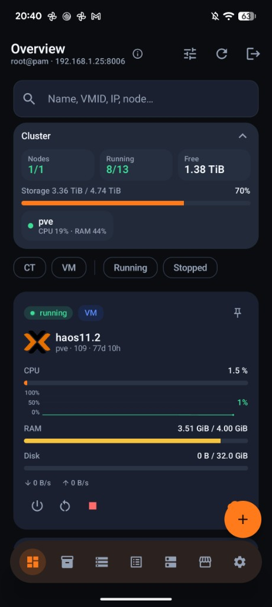
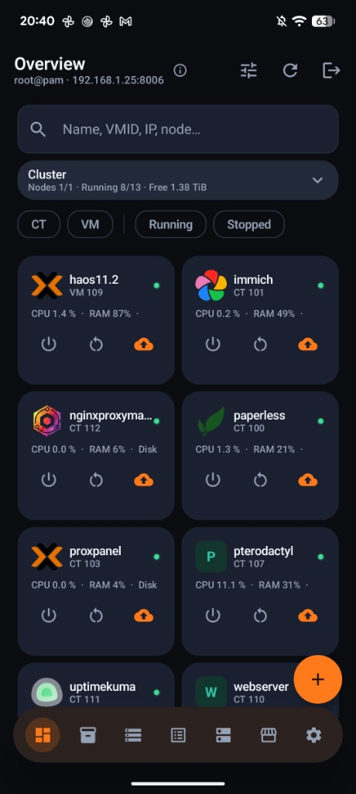
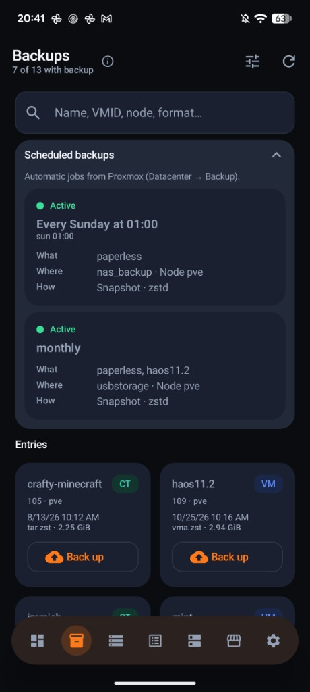
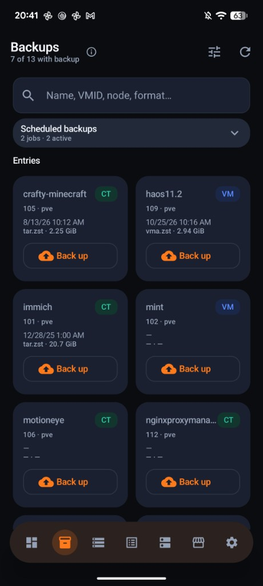
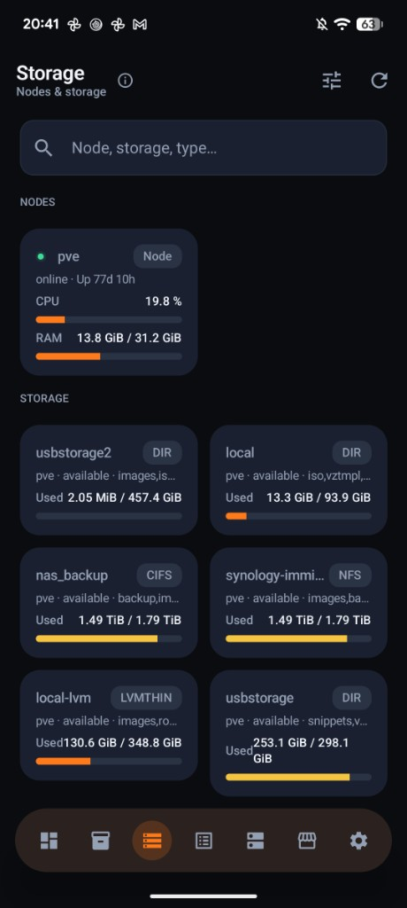
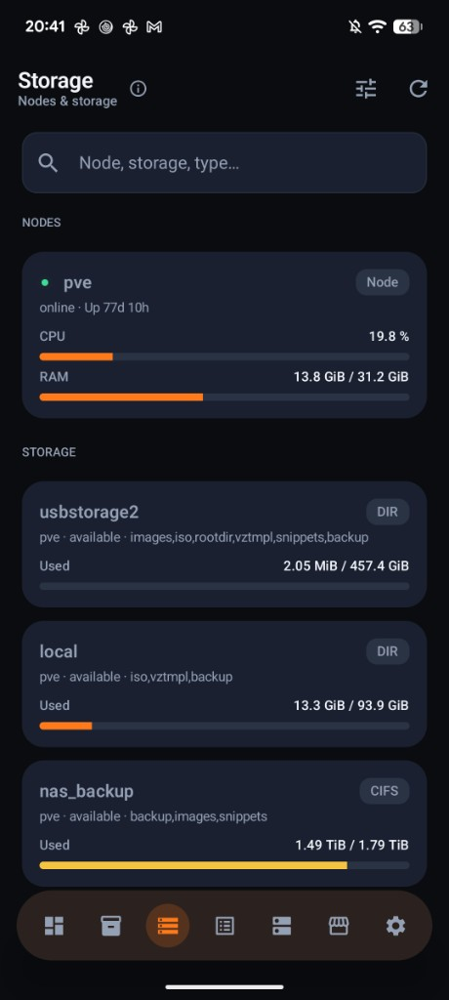
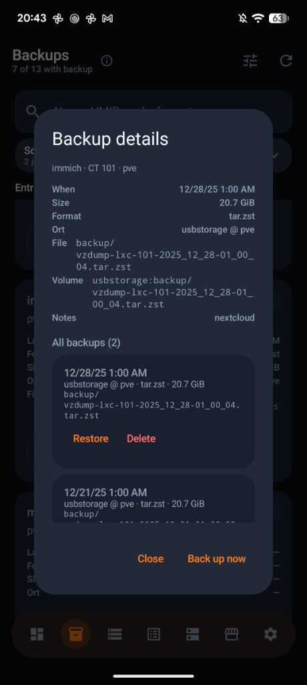

# ProxPanel Android

Native Android client for Proxmox VE — same core workflow as [ProxPanel web](https://github.com/fantrixx/ProxmoxWebApp), talking **directly** to the Proxmox API.

**Version:** 1.0.2 · Package: `com.proxpanel`  
**Privacy:** [Privacy policy](https://fantrixx.github.io/ProxPanel-Android/privacy.html)

## Screenshots

<p>
  
  
  
  
</p>
<p>
  
  
  
</p>

## Features

- **Overview** — CTs/VMs with live CPU/RAM, search, filters, power icons, quick backup, create FAB
- **Create guest** — simple CT/VM wizard (node, VMID, template/ISO, disk, password, advanced CPU/RAM/bridge)
- **Guest detail** — metrics, IPs, power, snapshots, backups (mode/compress/restore/delete), resource edit, console link
- **Backups** — scheduled jobs, overview with format/size/location, detail dialog, start/restore/delete
- **Storage** — nodes + storage utilization
- **Tasks** — recent cluster/node tasks with filters and live logs
- **Media** — ISO and LXC template inventory
- **Apps** — community-scripts marketplace (copy install command)
- **Settings** — language (EN/DE), accent, refresh interval, multi-server profiles

## Requirements

- Android 8.0+ (API 26)
- Reachable Proxmox VE (`https://<host>:8006`, port is defaulted if omitted)
- Android Studio Ladybug+ (or compatible) to build

## Build

```bash
./gradlew :app:assembleDebug
```

## Sign-in

| Field | Meaning |
|-------|---------|
| **Proxmox server** | e.g. `192.168.1.10` or `https://192.168.1.10:8006` |
| **Username / password / realm** | Same as Proxmox web UI |
| **Verify TLS** | Off for typical self-signed lab certs |

## Not yet (web-only / heavier)

- Interactive xterm console (opens Proxmox noVNC URL instead)
- Media upload, CD/DVD attach UI
- Server-side power/backup schedules (ProxPanel `.env` token runner)

## License

Personal / homelab use. Not affiliated with Proxmox Server Solutions GmbH.
